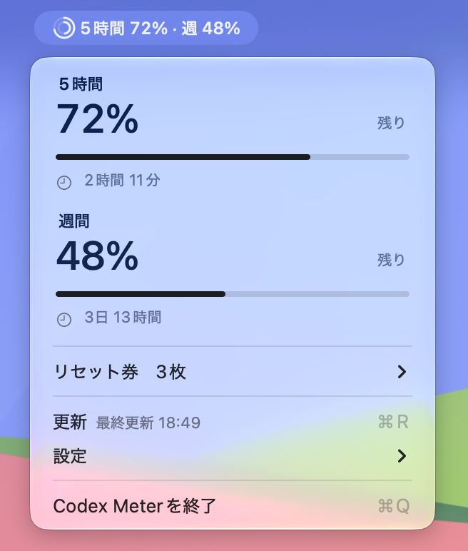

# Codex Meter

Codexの利用枠をメニューバーに表示する非公式macOSアプリです。残量、回復までの時間、リセットチケットの枚数・有効期限を確認できます。



## 対応環境

- Apple Silicon搭載Mac、macOS 15 Sequoia以降
- ChatGPTアカウントでログイン済みのCodex CLI（APIキーのみのログインは対象外）

動作確認済み：macOS 27.0.1。macOS 15での実機確認は未実施です。

## インストール

> [!IMPORTANT]
> ビルド済みアプリは配布していません。利用する場合は、[ソースからビルド](#ソースからビルド)してください。
>
> Developer ID署名とAppleの公証を受けていないため、macOSで起動が制限されることがあります。

1. Xcode Command Line ToolsまたはXcodeを用意します。
2. [ソースからビルド](#ソースからビルド)の手順でアプリをビルドしてインストールします。
3. Codex CLIが未ログインの場合は、ターミナルで `codex login` を実行します。
4. 通知を使う場合は、初回起動時に通知を許可します。

自動起動する場合は「システム設定 → 一般 → ログイン項目」に追加します。

## 使い方

| 項目 | 操作・表示内容 |
| --- | --- |
| 更新 | 5分ごと・スリープ復帰時に自動更新。手動更新は ⌘R |
| 表示の切り替え | 「設定 → 表示」で残量／使用量を切り替え |
| 二重リング | 外側は5時間枠、内側は週間枠 |
| リセットチケット | 「リセットチケット」で有効期限を確認 |
| 通知 | 利用枠の回復とチケットの追加を通知 |
| 取得エラー | `!` で表示。「接続エラー…」から詳細を確認 |
| 終了 | ⌘Q |

CLI側のアカウントの利用状況を表示します。サーバーが返さない枠やチケットの詳細は表示できず、アプリ終了中は監視しません。

## プライバシー

Codex CLIを通じてOpenAIから利用状況を取得します。アプリ独自に認証情報を読み取ったり複製したりせず、会話・モデル実行・リセットチケットの消費は行いません。

以下の情報をMacのUserDefaults（`local.codex.meter`）に保存します。

- アカウント識別用メールアドレス
- 利用枠とチケットの情報
- 取得日時
- 表示・通知設定

開発者への送信やアクセス解析は行いません。

## アンインストール

1. アプリを終了します。
2. ログイン項目から解除します。
3. アプリ本体を削除します。

保存情報も削除する場合は、アプリの終了後に以下を実行します。

```sh
defaults delete local.codex.meter
```

CLIのログイン情報は削除されません。

## ソースからビルド

Xcode Command Line ToolsまたはXcodeが必要です。

```sh
zsh build.sh    # build/Codex Meter.app を生成
zsh test.sh     # テスト
zsh install.sh  # ~/Applicationsへ配置・起動
```

`install.sh` は同名アプリを更新し、旧版のLaunchAgentがあれば無効化・退避します。自動起動は登録しません。

## ライセンス

[MIT License](LICENSE)
