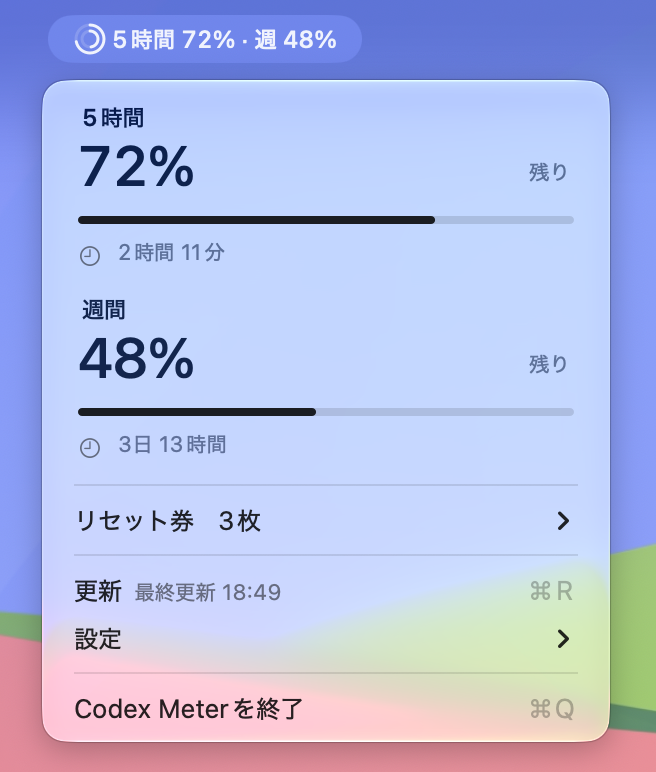

# Codex Meter

[日本語](README_ja.md)

Codex Meter is an unofficial macOS menu bar app for tracking Codex usage. See how much of your limit is left, when it resets, and how many reset tickets you have and when they expire.



## Requirements

- A Mac with Apple silicon running macOS 15 Sequoia or later
- Codex CLI signed in with a ChatGPT account. API key sign-in alone is not supported.

Previously tested on macOS 27.0.1. The app has not been tested on macOS 15.

## Installation

> [!IMPORTANT]
> Codex Meter is currently available as source only. Follow the [build instructions](#build-from-source) to install it.
>
> The app is not signed with a Developer ID or notarized by Apple, so macOS may block it from opening.

1. Install Xcode Command Line Tools or Xcode.
2. [Build and install the app](#build-from-source).
3. If you haven't signed in to Codex CLI, run `codex login` in Terminal.
4. To receive notifications, allow them when macOS asks.

To start Codex Meter at login, add it under **System Settings → General → Login Items**.

## Using Codex Meter

The app supports English and Japanese. It follows your macOS language preferences. To [set its language separately](https://support.apple.com/guide/mac-help/change-the-system-language-mh26684/mac), add Codex Meter under **System Settings → General → Language & Region → Applications**, then reopen the app.

| Feature | What it does |
| --- | --- |
| Refresh | Updates every five minutes and when the Mac wakes. Press ⌘R to refresh manually. |
| Display | Choose **Remaining** or **Usage** under **Settings → Display**. |
| Rings | The outer ring shows the five-hour limit. The inner ring shows the weekly limit. |
| Reset tickets | Open **Reset Tickets** to see expiration dates. |
| Notifications | Get notified when usage limits reset or reset tickets are added. |
| Connection errors | An exclamation mark (`!`) appears in the menu bar. Select **Connection Error…** for details. |
| Quit | Press ⌘Q. |

The app shows usage for the account signed in to Codex CLI. It can only display the limits and ticket details returned by Codex, and it stops monitoring when you quit.

## Privacy

Codex Meter fetches usage data from OpenAI through Codex CLI. The app does not read or copy credentials itself, start conversations, run models, or redeem reset tickets.

It stores the following on your Mac in UserDefaults (`local.codex.meter`):

- The email address used to identify your account
- Usage limits and reset ticket details
- The time the data was fetched
- Display and notification preferences

The app does not send data to its developer or collect analytics.

## Uninstall

1. Quit Codex Meter.
2. Remove it from Login Items if you added it there.
3. Delete the app.

To also remove its saved data and settings, run this after quitting:

```sh
defaults delete local.codex.meter
```

This does not sign you out of Codex CLI.

## Build from source

Run these commands from the repository with Xcode Command Line Tools or Xcode installed:

```sh
zsh build.sh    # Build build/Codex Meter.app
zsh test.sh     # Run the tests
zsh install.sh  # Install in ~/Applications and open
```

`install.sh` replaces any existing copy in `~/Applications`. If it finds the old LaunchAgent, it disables it and moves it to a backup. The script does not add the app to Login Items.

## License

[MIT License](LICENSE)
